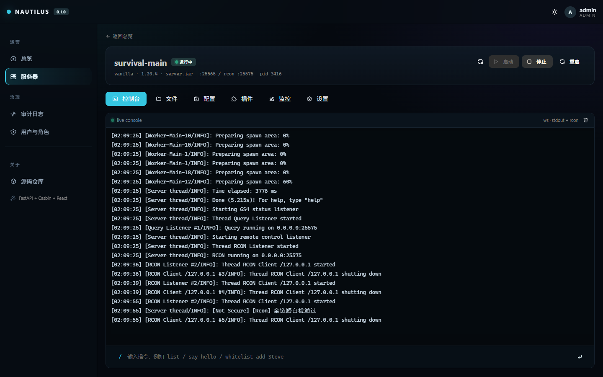
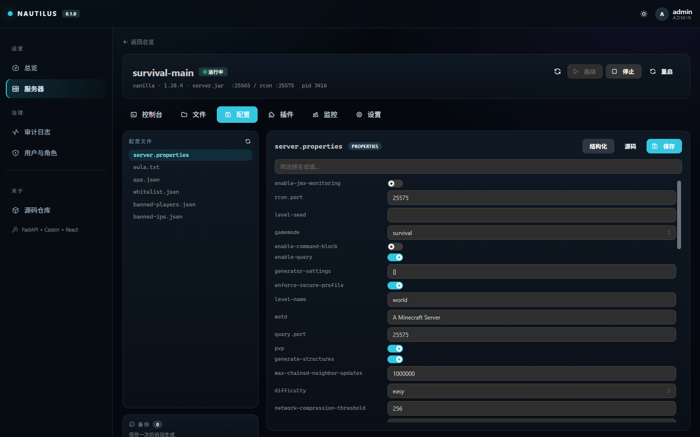
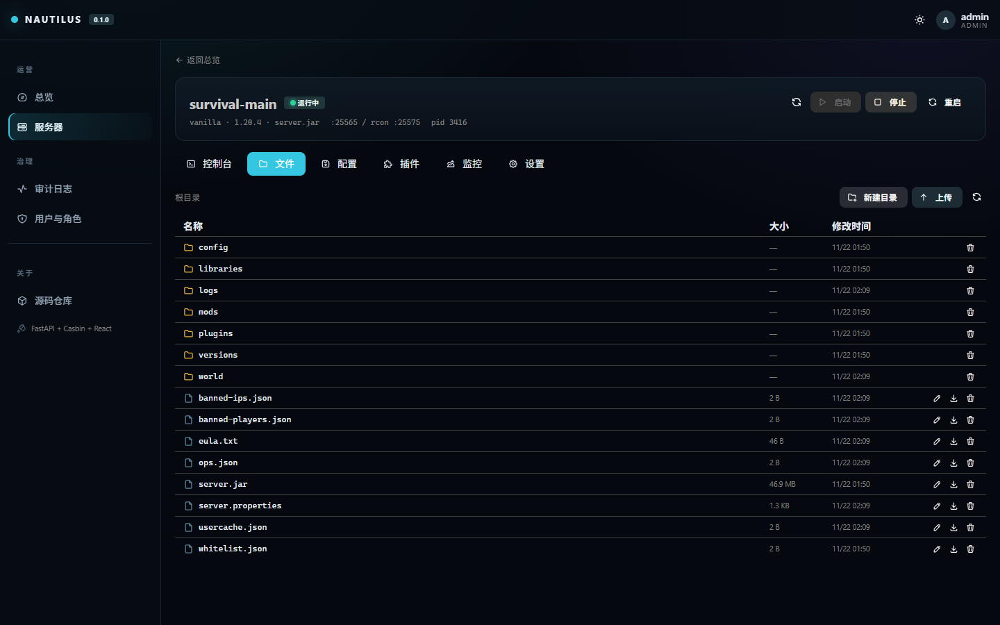
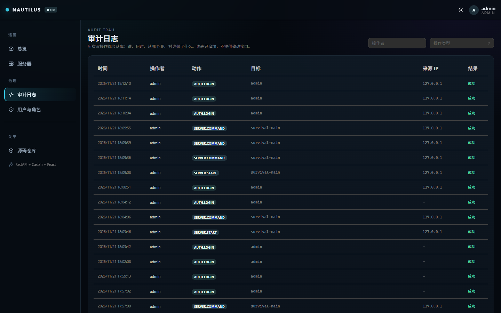

# Nautilus

**面向 Minecraft 服务端的高性能、可扩展 Web 管理面板。**

一个进程内即可跑起来的单机面板：启动/停止/重启、实时控制台、文件与配置编辑、插件市场、指标曲线、RBAC 权限与审计日志全部内置，
并且每一个模块都建立在成熟开源项目之上，而不是自己重写一遍。

<p>


</p>

---

## 截图

| 总览 | 实时控制台 |
| --- | --- |
|  |  |

| 指标监控 | 插件/数据包市场 |
| --- | --- |
|  |  |

<details>
<summary>更多界面：配置编辑器 / 文件管理 / 运行参数 / 用户与角色 / 审计日志</summary>

| 结构化配置编辑器 | 文件管理 |
| --- | --- |
|  |  |

| 运行参数 | 用户与角色 |
| --- | --- |
|  |  |



</details>

---

## 它支持什么

| 服务端类型 | 版本来源 | 备注 |
| --- | --- | --- |
| Paper | PaperMC **Fill v3** API | v2 已下线，代码只走 v3 |
| Purpur | Purpur v2 API | |
| Vanilla（原版） | Mojang piston-meta | 官方只发布 **SHA-1**，校验按 SHA-1 走 |
| Fabric / Forge* | Fabric Meta | 安装器启动后再拉取 loader |
| 基岩版 / 自定义 jar | 手动上传 | `POST /api/servers/{id}/jar` |

\* Forge 走"上传安装器 + 手动执行"的安全路径，面板不会替你执行任意 jar。

---

## 核心能力

### 1. 进程管理
- `asyncio.create_subprocess_exec` + 流式读取 stdout/stderr，逐行解析就绪信号（`Done (x.xxxs)!`）与玩家进出。
- **优雅停止阶梯**（移植自 [`itzg/mc-server-runner`](https://github.com/itzg/mc-server-runner)）：
  RCON `stop` → stdin `stop` → `SIGTERM`/Windows `CTRL_BREAK` → 宽限期后强杀；Windows 用 `taskkill /F /T` 连带结束进程树。
- 崩溃自动重启：指数退避（2/4/8…最多 60s，上限 10 次），手动停止不会触发。
- **进程树聚合**：Windows 上 `java.exe` 只是启动器，真正的 JVM 在子进程里，因此 CPU/RSS 按 `psutil` 进程树累加，
  CPU% 由累计 CPU 时间差分得出（单核满载 = 100%，多核可超过 100%，与 `top` 语义一致）。

### 2. Web 界面
- React 19 + Vite 7 + Mantine 8；控制台用 xterm.js，曲线用 uPlot（canvas，万点不掉帧）。
- 每个 Tab **按需分包**（`React.lazy`），首屏只加载登录页与总览；xterm 290KB、uPlot 56KB 打开才下载。
- WebSocket 复用登录 Cookie，不把 token 放进 query string（避免进 access log）。

### 3. 认证与权限
- [`fastapi-users`](https://github.com/fastapi-users/fastapi-users) 负责用户模型、Argon2 哈希、JWT 策略与 Cookie 传输；
  面板只做三件薄封装：用户名/邮箱二选一登录、`parse_id`（整型主键）、失败锁定（5 次 / 15 分钟，锁定与密码错误返回同一提示，避免账号枚举）。
- [`pycasbin`](https://github.com/casbin/pycasbin) 做 RBAC：`g` 角色继承 + `keyMatch`/`regexMatch` 匹配器，策略存数据库并物化为
  `rbac_model.conf` / `rbac_policy.csv`，**失败即拒绝**（enforcer 构建不出来时所有请求 403）。
- 审计日志：谁、何时、从哪个 IP、对什么做了什么，只追加不修改。

### 4. 日志与监控
- 控制台环形缓冲（默认 2000 行）+ 玩家集合，WS 断线重连后先推历史再增量。
- APScheduler 每 3s 采样一次（进程树 CPU/RSS、在线人数），保留 600 点在内存；**不落库**，避免时序数据污染业务表。
- 背压策略：每个订阅者一个 512 深的队列，满了丢最旧的一条并计数——生产者常是 MC 的 stdout 管道，绝不能阻塞。

### 5. 插件与配置
- 插件源：[Modrinth API v2](https://docs.modrinth.com/)（提供 SHA-1/SHA-512）与 [Hangar v1](https://hangar.papermc.io/)。
  **下载源不给哈希就拒绝安装**（防投毒）。按服务端类型自动换算内容目录与筛选条件：
  Paper/Purpur → `plugins/`，Fabric/Forge → `mods/`，原版 → `world/datapacks/`（原版没有插件加载器，只有数据包）。
- 配置编辑器：`server.properties`（jproperties）、`*.yml`（ruamel.yaml 保留注释）、`*.toml`（tomlkit）、`*.json`。
  写入流程恒定：**备份 → 语法校验 → 原子替换**（`os.replace`），每个文件保留最近 20 份备份在 `.nautilus/backups/`。

### 6. 扩展
`pluggy`（pytest 的插件引擎）提供 6 个钩子：`nautilus_startup` / `nautilus_routes` / `server_starting` / `server_started` /
`server_exited` / `console_line`。任一扩展抛异常只记日志，不会拖垮面板。

---

## 架构

```
┌──────────────────────────────────────────────────────────────┐
│  React SPA (Mantine + xterm + uPlot)                         │
│    REST /api/*        WebSocket /ws/servers/{id} · /ws/events │
└───────────────┬──────────────────────────────────────────────┘
                │  HttpOnly Cookie (JWT)
┌───────────────▼──────────────────────────────────────────────┐
│  Interface   FastAPI routers · WS endpoints · SPA static      │
├──────────────────────────────────────────────────────────────┤
│  Domain      servers/ (manager, provision, metrics, logbus)   │
│              resources/ (configs, files, plugins)             │
├──────────────────────────────────────────────────────────────┤
│  Platform    auth (fastapi-users) · authz (Casbin) ·          │
│              audit · events (pub/sub) · extensions (pluggy)   │
├──────────────────────────────────────────────────────────────┤
│  Infra       SQLAlchemy 2 async + aiosqlite (WAL) · Alembic   │
│              psutil · APScheduler · httpx                     │
└──────────────────────────────────────────────────────────────┘
```

设计文档：[`docs/research.md`](docs/research.md)（选型对比、API 可用性验证、风险清单、分阶段计划）、
[`docs/architecture.md`](docs/architecture.md)（分层、时序、数据模型、接口契约、安全模型）。

> **单 worker 是硬约束**：运行态（子进程句柄、日志缓冲、指标环形队列、WS 订阅）全部在进程内，
> 多 worker 会各看各的状态。要横向扩展，正确做法是把运行态搬到独立 agent，而不是加 worker。

---

## 快速开始

### 方式一：源码运行（推荐用于开发）

```bash
git clone https://github.com/flulwh/nautilus-mc.git
cd nautilus-mc

python -m venv .venv
# Windows: .venv\Scripts\activate
source .venv/bin/activate

# 国内网络建议加镜像： -i https://pypi.tuna.tsinghua.edu.cn/simple
pip install -e .

# 首次启动必须设置管理员密码
export NAUTILUS_BOOTSTRAP_ADMIN_PASSWORD='NautilusAdmin2026'
python -m nautilus
```

打开 <http://127.0.0.1:8199> ，用 `admin` / 上面设的密码登录。

前端已随包提供（`nautilus/webui/dist`）。需要改 UI 时：

```bash
cd frontend && npm install && npm run dev   # 5173，代理到 8199
```

### 方式二：Docker

```bash
cd deploy
echo "NAUTILUS_BOOTSTRAP_ADMIN_PASSWORD=$(openssl rand -base64 18)" > .env
docker compose up -d --build
```

镜像内已带 JRE 21（面板要真正拉起 JVM），数据卷为 `deploy/data`。

### 方式三：systemd

```bash
sudo useradd --system --home /opt/nautilus --shell /usr/sbin/nologin nautilus
sudo -u nautilus -H bash -c 'python3 -m venv /opt/nautilus/.venv && /opt/nautilus/.venv/bin/pip install nautilus-mc'
sudo install -d -o nautilus -g nautilus /opt/nautilus/data /etc/nautilus
sudo install -m 600 -o nautilus deploy/nautilus.env.example /etc/nautilus/nautilus.env
sudo install -m 644 deploy/nautilus.service /etc/systemd/system/
sudo systemctl enable --now nautilus
```

面板默认只监听 `127.0.0.1`，对外请套 Nginx/Caddy 做 TLS，并把 `NAUTILUS_COOKIE_SECURE` 设为 `true`。

---

## 配置

全部通过 `NAUTILUS_*` 环境变量或 `.env` 覆盖（见 [`deploy/nautilus.env.example`](deploy/nautilus.env.example)）。

| 变量 | 默认值 | 说明 |
| --- | --- | --- |
| `NAUTILUS_HOST` / `NAUTILUS_PORT` | `127.0.0.1` / `8199` | 监听地址 |
| `NAUTILUS_ROOT_PATH` | 空 | 反代子路径，如 `/panel` |
| `NAUTILUS_DATA_DIR` | `data` | 数据库、RBAC 文件、所有服务端目录的根 |
| `NAUTILUS_SECRET_KEY` | 自动生成 | 留空则写入 `<data>/.secret` |
| `NAUTILUS_BOOTSTRAP_ADMIN_PASSWORD` | 空 | **首次启动必填**，之后可删 |
| `NAUTILUS_COOKIE_SECURE` | `false` | HTTPS 下改 `true` |
| `NAUTILUS_TOKEN_TTL_MINUTES` | `120` | 登录有效期 |
| `NAUTILUS_ALLOW_REGISTRATION` | `false` | 是否允许自助注册 |
| `NAUTILUS_FORWARDED_ALLOW_IPS` | `127.0.0.1` | 信任的 `X-Forwarded-For` 来源 |
| `NAUTILUS_JAVA` | `java` | 默认 JRE 路径，可按服务器覆盖 |
| `NAUTILUS_METRICS_INTERVAL` | `3.0` | 采样间隔（秒） |
| `NAUTILUS_METRICS_POINTS` | `600` | 内存中保留的采样点数 |
| `NAUTILUS_MAX_LOG_LINES` | `2000` | 控制台环形缓冲行数 |
| `NAUTILUS_STOP_GRACE_SECONDS` | `30` | 优雅停止宽限期 |
| `NAUTILUS_LOG_LEVEL` | `info` | |

数据目录结构：

```
data/
├── nautilus.db            # 用户、服务器、策略、审计、插件记录（WAL）
├── .secret                # 自动生成的 JWT 密钥（0600）
├── rbac_model.conf        # 由数据库物化
├── rbac_policy.csv        # 由数据库物化
└── servers/<id>/          # 每个服务端一个独立目录
    ├── server.jar
    ├── server.properties
    └── .nautilus/backups/ # 配置备份环
```

---

## 权限模型

角色继承：`admin → operator → moderator → viewer`（子角色自动继承父角色权限）。

| 角色 | 权限 |
| --- | --- |
| `admin` | `* / .*` 全部，含用户管理与策略编辑 |
| `operator` | 服务端 `read/control/console/files/config/plugins/create/install` + 审计只读 |
| `moderator` | 服务端 `read/console`（能看能发指令，不能改文件/配置） |
| `viewer` | 服务端 `read` |

对象为 `server` / `users` / `audit` / `system`，动作为 `read/create/delete/control/console/files/config/plugins/install/manage`。
策略存在 `policies` 表，改完调用 `authz.reload_from_db()` 热加载，无需重启。

---

## API 与 WebSocket

完整契约见 `/api/docs`（Swagger UI）。主要分组：

```
POST   /api/auth/signin                 # 用户名或邮箱 + 密码，下发 HttpOnly Cookie
GET    /api/auth/me                     # 当前用户 + 权限列表
GET    /api/servers                     # 列表（含 runtime 快照）
POST   /api/servers                     # 创建（自动建目录、写默认配置）
POST   /api/servers/{id}/install        # 后台下载服务端 jar（带进度）
POST   /api/servers/{id}/{start|stop|restart|kill}
POST   /api/servers/{id}/command        # RCON 优先，回退 stdin
GET    /api/servers/{id}/{logs|metrics|players}
GET    /api/servers/{id}/files?path=    # 沙箱目录浏览
GET/PUT /api/servers/{id}/config/{path} # 结构化读写 + backups/restore/raw
GET    /api/servers/{id}/plugins/search # Modrinth / Hangar 聚合搜索
POST   /api/servers/{id}/plugins/install
GET    /api/audit                       # 审计日志
```

WebSocket：

```
/ws/servers/{id}    → {"t":"state"|"log"|"players"|"metrics"|"metrics_history"|"history"|"progress"|"ping", ...}
/ws/events          → 全局事件（所有服务端的状态变化）
```

握手用 Cookie 认证，鉴权失败以 `4401` 关闭、服务器不存在以 `4404` 关闭，客户端据此区分"重登"与"删了"。

---

## 写一个扩展

```python
# my_ext/plugin.py
from nautilus.extensions import hookimpl


class MyExt:
    @hookimpl
    def nautilus_startup(self, app, bus):
        app.state.my_ext = True

    @hookimpl
    def console_line(self, server_id: int, line: str, level: str):
        if "ERROR" in line:
            ...  # 推送到你自己的告警通道
```

```toml
# pyproject.toml
[project.entry-points."nautilus.extensions"]
my_ext = "my_ext.plugin"
```

装上即生效，`GET /api/meta` 的 `extensions` 字段会列出已加载的扩展。

---

## 测试

```bash
pytest -q                     # 24 项：认证、RBAC、服务器生命周期、WebSocket 契约
python scripts/e2e_vanilla.py # 真机 E2E：下载 1.20.4 → 启动 → RCON list → 采样 → 优雅停止
```

E2E 会真的下载 47MB 服务端 jar、真的拉起 JVM，输出 `E2E OK` 才算通过。

---

## 技术选型（为什么不是自己写）

| 能力 | 选用 | 理由 |
| --- | --- | --- |
| 进程监管 | `asyncio.subprocess` + psutil + `itzg/mc-server-runner` 的停止阶梯 | 停止逻辑的边界条件（RCON 不可用、JVM 忽略 SIGTERM）是被反复踩过的坑 |
| Web 框架 | FastAPI | 原生 async、Pydantic 校验、OpenAPI 自动生成 |
| 认证 | `fastapi-users` | 用户 CRUD、哈希、JWT、Cookie 传输都是现成的，且有维护 |
| 权限 | `pycasbin` | RBAC + 继承 + 正则匹配，策略可热加载 |
| 迁移 | `alembic` | 面板升级不能要求用户删库 |
| 定时任务 | `APScheduler` | 采样与清理，比手写 `asyncio.sleep` 循环可控 |
| 限流 | `slowapi` | 登录接口需要，避免自己实现漏桶 |
| 配置解析 | `ruamel.yaml` / `jproperties` / `tomlkit` | **保留注释与顺序**，这是"能改配置"和"能安全改配置"的分界 |
| 插件市场 | Modrinth API / Hangar API | 覆盖 99% 生态，且提供哈希 |
| 扩展机制 | `pluggy` | pytest 同款，语义稳定 |
| 前端 | React + Mantine + xterm + uPlot | 控制台与曲线是最吃性能的两块，直接用成熟组件 |

---

## 已知边界

- **单进程**：不支持 `--workers > 1`，理由见上文。
- **SQLite**：单机数千 QPS 够用。要多实例，正确做法是把运行态拆成独立 agent、数据库换 PostgreSQL
  （需同时改 `nautilus/db.py` 的 URL 与 `alembic.ini`，当前未提供开关）。
- **无内置 TLS**：请用 Nginx/Caddy 终止 TLS。
- **Java**：面板只负责启动 `java`，不管理 JDK；MC 1.21+ 需要 Java 21，请在"运行参数"里按服务器指定路径。
- **Windows**：优雅停止依赖 `CTRL_BREAK_EVENT`，部分包装脚本会吞掉该信号，此时会退化为强杀。
- **安全**：面板能以服务账号身份执行任意 JVM 参数，请只授予可信用户 `admin`/`operator`；建议以独立系统用户运行并对数据目录做最小权限。

---

## 目录结构

```
nautilus/
├── api/            # 路由：servers / files / configs / plugins / system
├── auth/           # fastapi-users 集成（backend, router, schemas）
├── servers/        # 进程监管、jar 分发、指标采样、日志解析、RCON
├── resources/      # 配置文件读写、文件沙箱、插件市场
├── webui/dist/     # 构建后的前端
├── ws.py           # 控制台/事件 WebSocket
├── authz.py        # Casbin 封装
├── events.py       # 进程内 pub/sub（有界队列 + 丢旧）
├── extensions.py   # pluggy 钩子
├── models.py / db.py / settings.py / audit.py
frontend/src/       # React 源码
migrations/         # Alembic
deploy/             # Dockerfile / compose / systemd / env 样例
docs/               # 调研与架构文档、截图
tests/              # pytest
scripts/            # 真机 E2E
```

---

## 致谢

本项目的每一个"轮子"都来自上游：[fastapi-users](https://github.com/fastapi-users/fastapi-users)、[Casbin](https://github.com/casbin/pycasbin)、
[Alembic](https://alembic.sqlalchemy.org/)、[APScheduler](https://github.com/agronholm/apscheduler)、[pluggy](https://github.com/pytest-dev/pluggy)、
[psutil](https://github.com/giampaolo/psutil)、[mcstatus](https://github.com/py-mine/mcstatus)、[async-mcrcon](https://github.com/kevinlindev/async-mcrcon)、
[Mantine](https://mantine.dev/)、[xterm.js](https://xtermjs.org/)、[uPlot](https://github.com/leeoniya/uPlot)，
以及 [itzg/mc-server-runner](https://github.com/itzg/mc-server-runner) 的停止阶梯设计。

## License

[MIT](LICENSE) © flulwh
