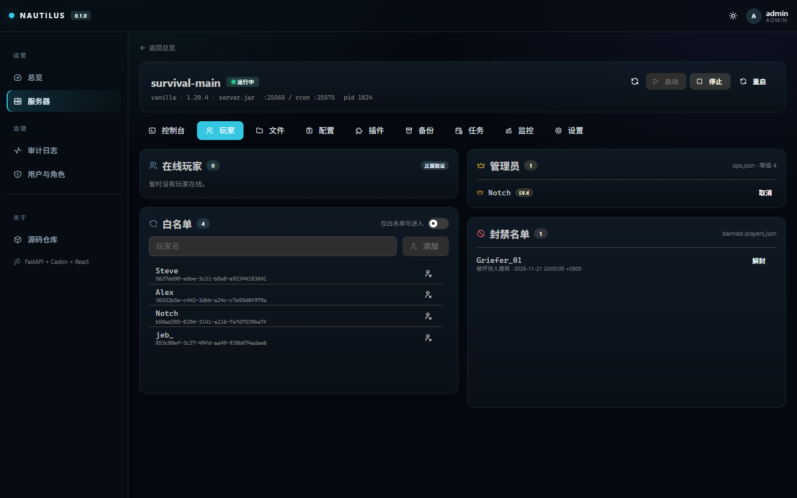
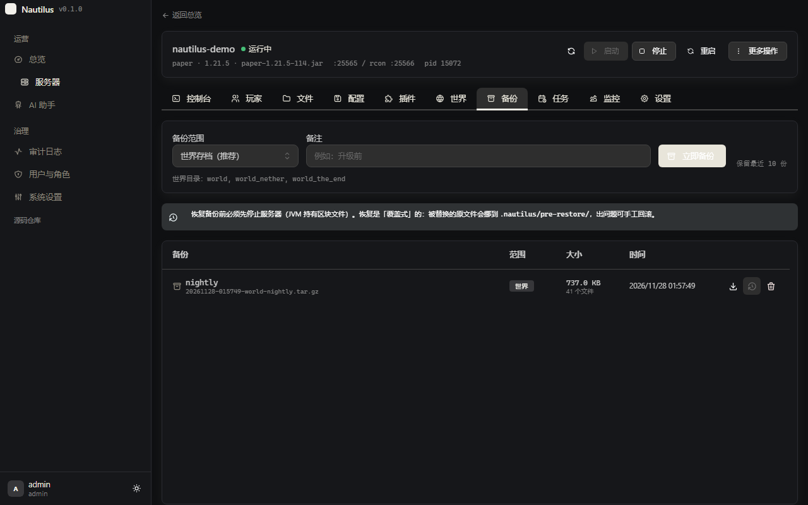
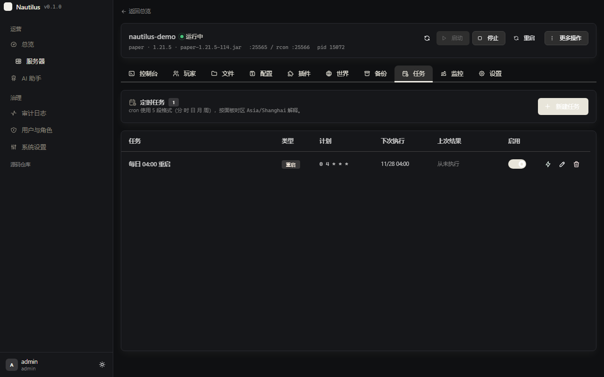
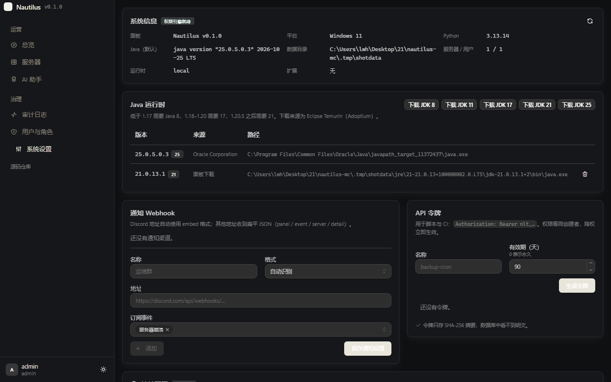

# Nautilus

**面向 Minecraft 服务端的高性能、可扩展 Web 管理面板。**

一个进程内即可跑起来的单机面板：启动/停止/重启、实时控制台、玩家与白名单、世界备份与恢复、定时任务、
文件与配置编辑、插件市场、指标曲线、RBAC 权限与审计日志全部内置，并且每一个模块都建立在成熟开源项目之上，而不是自己重写一遍。

<p>


</p>

---

## 截图

| 总览 | 实时控制台 |
| --- | --- |
|  |  |

| 指标监控 | 插件/数据包市场 |
| --- | --- |
|  |  |

| 玩家与白名单 | 世界备份与恢复 |
| --- | --- |
|  |  |

| 定时任务 |
| --- |
|  |

<details>
<summary>更多界面：配置编辑器 / 文件管理 / 运行参数 / 用户与角色 / 审计日志</summary>

| 结构化配置编辑器 | 文件管理 |
| --- | --- |
|  |  |

| 运行参数 | 用户与角色 |
| --- | --- |
|  |  |


</details>

---

## 它支持什么

| 服务端类型 | 版本来源 | 备注 |
| --- | --- | --- |
| Paper | PaperMC **Fill v3** API | v2 已下线，代码只走 v3 |
| Purpur | Purpur v2 API | |
| Vanilla（原版） | Mojang piston-meta | 官方只发布 **SHA-1**，校验按 SHA-1 走 |
| Fabric / Quilt | Fabric Meta | loader 版本自动取 stable |
| Forge | Forge promotions + maven 安装器 | 面板执行 `--installServer`，自动识别 shim jar |
| NeoForge | NeoForge maven 元数据 + 安装器 | 同上，版本号自动映射到 Minecraft 版本 |
| 基岩版 / 自定义 jar | 手动上传 | `POST /api/servers/{id}/jar` |

Forge / NeoForge 的安装流程与 [`itzg/mc-image-helper`](https://github.com/itzg/mc-image-helper) 的
`ForgeLikeInstaller` 一致：下载官方安装器 → `java -jar <installer> --installServer` →
在 `libraries/` 里解析依赖并生成 `forge-*-shim.jar`，面板把该 shim 记作启动 jar，因此 stdin / RCON /
停止阶梯对所有服务端类型保持同一套逻辑。

---

## 核心能力

### 1. 进程管理
- `asyncio.create_subprocess_exec` + 流式读取 stdout/stderr，逐行解析就绪信号（`Done (x.xxxs)!`）与玩家进出。
- **优雅停止阶梯**（移植自 [`itzg/mc-server-runner`](https://github.com/itzg/mc-server-runner)）：
  RCON `stop` → stdin `stop` → `SIGTERM`/Windows `CTRL_BREAK` → 宽限期后强杀；Windows 用 `taskkill /F /T` 连带结束进程树。
- 崩溃自动重启：指数退避（2/4/8…最多 60s，上限 10 次），手动停止不会触发；健康运行 5 分钟后计数归零。
- **Java 运行时管理**：探测 `PATH` / `JAVA_HOME` / 面板下载目录，按服务端版本要求从 Adoptium
  （Eclipse Temurin）下载 JRE 8/11/17/21/25，校验 SHA-256 后解压到 `data/jre/<major>-<version>`。
- **进程树聚合**：Windows 上 `java.exe` 只是启动器，真正的 JVM 在子进程里，因此 CPU/RSS 按 `psutil` 进程树累加，
  CPU% 由累计 CPU 时间差分得出（单核满载 = 100%，多核可超过 100%，与 `top` 语义一致）。

### 2. Web 界面
- React 19 + Vite 7 + Mantine 8；控制台用 xterm.js，曲线用 uPlot（canvas，万点不掉帧）。
- 每个 Tab **按需分包**（`React.lazy`），首屏只加载登录页与总览；xterm 290KB、uPlot 56KB 打开才下载。
- WebSocket 复用登录 Cookie，不把 token 放进 query string（避免进 access log）。
- **工业控制台主题**：默认亮色（浅灰底、深墨字、单一工程蓝强调色、方角 1px 边框、无阴影渐变），可切暗色；
  终端与代码编辑器始终是独立的深色面板。
- **权限感知**：服务器详情的 Tab 按当前角色的 Casbin 权限显示，低权限角色看不到点了就 403 的按钮；
  删除服务器等敏感操作单独判断。总览的「新建」也按 `server:create` 隐藏。
- **个人设置**：菜单里可改自己的密码（校验当前密码），页面同时列出当前账号的角色与展开后的权限清单。
- **统一的交互**：所有删除确认走同一套 Modal（不再混用浏览器原生弹窗）；列表页统一空/加载/错误三态；
  文件管理支持重命名、搜索、隐藏文件开关，插件支持检查更新与搜索分页，审计支持展开详情与导出 CSV，
  监控支持时间窗口切换，系统设置展示运行时信息。

### 3. 认证与权限
- [`fastapi-users`](https://github.com/fastapi-users/fastapi-users) 负责用户模型、Argon2 哈希、JWT 策略与 Cookie 传输；
  面板只做三件薄封装：用户名/邮箱二选一登录、`parse_id`（整型主键）、失败锁定（5 次 / 15 分钟，锁定与密码错误返回同一提示，避免账号枚举）。
- [`pycasbin`](https://github.com/casbin/pycasbin) 做 RBAC：`g` 角色继承 + `keyMatch`/`regexMatch` 匹配器，策略存数据库并物化为
  `rbac_model.conf` / `rbac_policy.csv`，**失败即拒绝**（enforcer 构建不出来时所有请求 403）。
- 审计日志：谁、何时、从哪个 IP、对什么做了什么，只追加不修改。

### 4. 日志与监控
- 控制台环形缓冲（默认 2000 行）+ 玩家集合，WS 断线重连后先推历史再增量。
- APScheduler 每 3s 采样一次（进程树 CPU/RSS、在线人数），保留 600 点在内存；**不落库**，避免时序数据污染业务表。
- 背压策略：每个订阅者一个 512 深的队列，满了丢最旧的一条并计数——生产者常是 MC 的 stdout 管道，绝不能阻塞。

### 5. 插件与配置
- 插件源：[Modrinth API v2](https://docs.modrinth.com/)（提供 SHA-1/SHA-512）与 [Hangar v1](https://hangar.papermc.io/)。
  **下载源不给哈希就拒绝安装**（防投毒）。按服务端类型自动换算内容目录与筛选条件：
  Paper/Purpur → `plugins/`，Fabric/Forge/NeoForge → `mods/`，原版 → `<世界>/datapacks/`（原版没有插件加载器，只有数据包）。
- 配置编辑器：`server.properties`（jproperties）、`*.yml`（ruamel.yaml 保留注释）、`*.toml`（tomlkit）、`*.json`。
  写入流程恒定：**备份 → 语法校验 → 原子替换**（`os.replace`），每个文件保留最近 20 份备份在 `.nautilus/backups/`。

### 6. 备份与恢复
- 整目录 `tar.gz` 归档，三种范围：**世界存档**（按 `server.properties` 的 `level-name` 自动找出 `world` / `world_nether` / `world_*`）、
  **仅配置**、**全部文件**；自动排除 `logs/`、`cache/` 与面板自身的元数据。
- 与配置文件的小备份（`.nautilus/backups/`，每文件 20 份）分开存放：这里是 `.nautilus/archives/`，按份数保留（默认 10 份，超出自动淘汰）。
- 恢复**要求先停机**（JVM 持有区块文件，热覆盖会损坏存档），解包前校验归档成员（拒绝绝对路径、`..`、符号链接与设备文件），
  被替换的原文件先挪进 `.nautilus/pre-restore/<时间戳>/`，失败自动回滚。
- 打包/解包跑在 `asyncio.to_thread`，进度经 WebSocket 推给前端；元数据写在同名 `.json` 侧车，列表不必解压。

### 7. 玩家管理
- 在线玩家来自日志解析，操作走 RCON；白名单 / OP / 封禁直接维护 `whitelist.json`、`ops.json`、`banned-players.json`。
- UUID 解析：正版模式查 Mojang 官方 profile 接口（带缓存与超时），离线模式按 Minecraft 自身的 `OfflinePlayer:<name>` MD5 规则推导，
  所以离线服的条目不会和服务器自己生成的重复。
- **写序很重要**：`whitelist add` 会让服务端把内存里的列表回写 JSON，所以顺序固定为
  `whitelist reload`（把磁盘状态读进内存）→ RCON 命令 → 面板落盘，避免面板刚加的条目被服务端的内存副本覆盖。
- **游戏统计**：直接读 `world/stats/*.json` 与 `usercache.json`，展示每个玩家的游戏时长、死亡、击杀与最后在线，
  不额外落库，也不会和服务器自己的统计产生偏差。

### 8. 定时任务
- 任务存在 `scheduled_tasks` 表（Alembic 迁移），APScheduler `CronTrigger` 按面板时区解释 5 段 cron，重启后自动重建。
- 六种动作：重启 / 启动 / 停止 / 强制结束 / 备份 / 控制台指令；可单独启停、立即执行，执行结果（成功/失败 + 输出）持久化并显示在列表里。
- 任务异常写入 `last_result` 而不是抛出，避免一次失败让调度器静默丢任务。

### 9. 世界管理
- 扫描服务器目录里所有含 `level.dat` 的目录，显示大小、维度（下界/末地）与当前使用状态；切换世界只是改
  `server.properties` 的 `level-name`，下次启动生效。
- 新建世界支持种子与地形类型；删除世界**移动到** `.nautilus/world-trash/`，且拒绝删除当前世界。
- 玩法设置（难度、游戏模式、视距、模拟距离、正版验证、PVP、白名单、MOTD…）带类型与范围校验，
  写入前自动备份 `server.properties`；所有写操作都要求服务器已停止，避免 JVM 持有区块文件时损坏存档。

### 10. 系统设置
- **通知 Webhook**：服务器启动/停止/崩溃、备份完成/恢复、任务失败、安装失败、玩家进出都可推送。
  Discord 地址自动用 embed，其他地址收到扁平 JSON；投递在后台任务里完成，8 秒超时，失败只记日志。
- **API 令牌**：`Authorization: Bearer nlt_…`，与应用内 Cookie 认证走同一个权限守卫，角色实时读取，
  令牌只存 SHA-256 摘要，可设有效期并随时吊销。

### 11. 扩展
`pluggy`（pytest 的插件引擎）提供 6 个钩子：`nautilus_startup` / `nautilus_routes` / `server_starting` / `server_started` /
`server_exited` / `console_line`。任一扩展抛异常只记日志，不会拖垮面板。

### 12. AI 助手
用自然语言操纵面板：启停服务器、发控制台命令、读写文件与配置、装插件、做备份、切世界、管玩家，
共 **36 个工具**，覆盖上面所有能力。

- **接哪家模型**：任何 OpenAI 兼容端点（DeepSeek / 通义千问 / Kimi / 智谱 / OpenAI / 本地 Ollama），
  在「系统设置 -> AI 助手」填 `base_url` + `model` + `api_key` 即可，带「测试连接」按钮。
- **模型列表直接拉**：点「获取模型列表」从端点的 `/v1/models` 读出模型名；选「本地 Ollama」预设会自动拉一次，
  并额外读原生 `/api/tags` 补上参数量、量化等级和体积，不用再手抄 `qwen2.5:7b` 这种名字。
  端点填根地址或 `.../v1` 都行；本机/容器地址的 Ollama 不需要 API Key。
- **agent 循环**：用 [Pydantic AI](https://github.com/pydantic/pydantic-ai)（Pydantic 官方，MIT），
  不自己写 tool-calling 状态机；工具声明为普通 async 函数，schema 由签名生成。
- **任务清单与运维手册**：多步任务用 `update_plan` 显式列步骤，前端实时显示进度；
  6 份运维手册（启动失败、装插件、备份恢复、玩家、世界、卡顿）按需 `load_playbook` 加载，
  对应 Claude Agent SDK 的 Skills 渐进披露与 Claude Code 的 TodoWrite 模式。
- **能真正停下来**：浏览器上的「停止」会调 `POST /api/ai/cancel`，通过 pydantic-ai 的
  `CancellationToken` 取消 run 本身；已经完成的工具调用保留在对话里，不会重复执行。
- **多会话**：左侧列出历史会话，可新建、切换、重命名、删除；切回去会把工具调用和回答一起还原。
  每个会话按登录用户隔离，标题自动取第一句提问。
- **上下文压缩**：发给模型的旧工具结果先压到 700 字符（`ProcessHistory`）；历史再长就自动
  用同一个模型把旧轮次摘要化，从用户提问边界开始裁剪，最近 10 轮保持原文。也可以点
  「压缩上下文」手动触发（`POST .../compact`，支持 focus）。压缩过程会发 SSE `compacted` 事件。
- **工具超时**：只读工具 60s、写操作 120s、安装/恢复 300s，卡住不会拖死整轮。
- **一发送就有反应**：点发送的同一帧就插入你的消息和「正在思考」骨架；模型调用开始即发
  SSE `started` 事件切到「思考中」，不用等首个字节，界面不会空白干等。
- **看得到推理过程**：推理模型（DeepSeek-R1 / qwen3 / o 系列等）的 `reasoning_content` /
  `reasoning` 会被解析成 SSE `thinking` 事件，在回答上方以可折叠的「思考过程」区实时流式显示，
  正文开始后自动标记完成。不支持推理的模型则没有这一块。
- **提示词反馈协议**：提示词要求模型每次调工具前先用一句话说明要做什么；配合前端的
  状态机（就绪/连接中/思考中/生成中/出错）、逐条工具耗时与可展开结果、流式光标，不用猜它在干嘛。
  每轮还会动态注入当前时间和操作者角色，只读账号会被明确提醒不能写。
- **权限不旁路**：工具以**当前登录账号**的角色执行，走与 HTTP 路由同一套 Casbin 策略。
  AI 永远不会比调用它的人权限大；每次写操作都进审计日志（`ai.<tool_name>`）。
- **危险操作要确认**：删世界、删插件、覆盖文件、恢复备份、强杀进程标记为 `dangerous`，
  默认停下来等你在界面上点「确认执行」；服务端会核对审批 id 与有效期，过期或重复点击直接拒绝。
  可以在设置里关掉确认。
- **流式输出**：`POST /api/ai/chat` 返回 SSE，前端实时看到文字增量、任务清单、每次工具调用与结果。
- **也能被外部 agent 驱动**：`python -m nautilus.mcp_server` 起一个 MCP server，把同一批工具
  暴露给 Claude Desktop / Cursor 等 —— 与面板内置对话共享权限模型与审计。

### 13. 地址配置

系统设置页的「地址配置」统一管理四类地址，都不需要改代码或环境变量：

| 地址 | 填在哪 | 用途 |
|---|---|---|
| 面板对外地址 | 系统设置 → 地址配置 | 生成可分享的链接、MCP 说明；留空则按访问请求的 Host 自动推断 |
| AI 模型端点 | 系统设置 → AI 助手 | `base_url`，任意 OpenAI 兼容服务；已支持自填任意地址 |
| MC 进服地址 | 服务器 → 设置 → 玩家连接地址 | 如 `mc.example.com:25565`；AI 回答「怎么进服」时读这里，不再是本机端口 |
| MCP 地址 | 系统设置 → 地址配置 | 传输模式（stdio / http）、监听地址与端口，页面直接给出可复制的客户端配置片段 |

MCP 默认 stdio（由客户端拉起，最安全）；切到 http 后常驻监听，默认只绑 `127.0.0.1`。
改成 `0.0.0.0` 等于把「能操纵全部服务器」的接口开到局域网，界面会给出警告，请务必配合防火墙/反代。
命令行 `--http` / `--host` / `--stdio` 可临时覆盖配置。

旧版本面板没有这些接口：如果界面显示「接口不存在」或一直停在「读取中」，重启面板加载新代码即可。

API Key 用 Fernet 加密后存库（密钥由 `NAUTILUS_SECRET_KEY` / `<data>/.secret` 派生），
接口只回显尾号；换过 `secret_key` 之后旧密文解不开，需要重新填一次。

---

## 架构

```
┌──────────────────────────────────────────────────────────────┐
│  React SPA (Mantine + xterm + uPlot)                         │
│    REST /api/*        WebSocket /ws/servers/{id} · /ws/events │
└───────────────┬──────────────────────────────────────────────┘
                │  HttpOnly Cookie (JWT)
┌───────────────▼──────────────────────────────────────────────┐
│  Interface   FastAPI routers · WS endpoints · SPA static      │
├──────────────────────────────────────────────────────────────┤
│  Domain      servers/ (manager, provision, metrics, logbus)   │
│              resources/ (configs, files, plugins)             │
├──────────────────────────────────────────────────────────────┤
│  Platform    auth (fastapi-users) · authz (Casbin) ·          │
│              audit · events (pub/sub) · extensions (pluggy)   │
├──────────────────────────────────────────────────────────────┤
│  Infra       SQLAlchemy 2 async + aiosqlite (WAL) · Alembic   │
│              psutil · APScheduler · httpx                     │
└──────────────────────────────────────────────────────────────┘
```

设计文档：[`docs/research.md`](docs/research.md)（选型对比、API 可用性验证、风险清单、分阶段计划）、
[`docs/architecture.md`](docs/architecture.md)（分层、时序、数据模型、接口契约、安全模型）。

> **单 worker 是硬约束**：运行态（子进程句柄、日志缓冲、指标环形队列、WS 订阅）全部在进程内，
> 多 worker 会各看各的状态。要横向扩展，正确做法是把运行态搬到独立 agent，而不是加 worker。

---

## 快速开始

### 方式零：一键启动（最省事）

拿到源码后不用管虚拟环境和依赖，直接：

| 平台 | 做法 |
| --- | --- |
| Windows | 双击 `start.bat` |
| Linux / macOS | `./start.sh` |

首次运行会自动建 `.venv`、装依赖、引导你设置管理员密码，然后启动面板并打开浏览器；
再次运行会跳过安装直接起。常用参数：

```bash
start.bat --port 8200        # 换端口
start.bat --host 0.0.0.0     # 允许局域网访问
start.bat --no-browser       # 不自动开浏览器
```

按 Ctrl+C 停止。依赖装不上时脚本会提示手动命令；国内网络默认走清华镜像
（可用 `NAUTILUS_PIP_INDEX` 覆盖，装不上会自动回落官方 PyPI）。

### 方式一：源码运行（推荐用于开发）

```bash
git clone https://github.com/flulwh/nautilus-mc.git
cd nautilus-mc

python -m venv .venv
# Windows: .venv\Scripts\activate
source .venv/bin/activate

# 国内网络建议加镜像： -i https://pypi.tuna.tsinghua.edu.cn/simple
pip install -e .

# 首次启动必须设置管理员密码
export NAUTILUS_BOOTSTRAP_ADMIN_PASSWORD='NautilusAdmin2026'
python -m nautilus
```

打开 <http://127.0.0.1:8199> ，用 `admin` / 上面设的密码登录。

前端已随包提供（`nautilus/webui/dist`）。需要改 UI 时：

```bash
cd frontend && npm install && npm run dev   # 5173，代理到 8199
```

### 方式二：Docker

```bash
cd deploy
echo "NAUTILUS_BOOTSTRAP_ADMIN_PASSWORD=$(openssl rand -base64 18)" > .env
docker compose up -d --build
```

镜像内已带 JRE 21（面板要真正拉起 JVM），数据卷为 `deploy/data`。

### 方式三：systemd

```bash
sudo useradd --system --home /opt/nautilus --shell /usr/sbin/nologin nautilus
sudo -u nautilus -H bash -c 'python3 -m venv /opt/nautilus/.venv && /opt/nautilus/.venv/bin/pip install nautilus-mc'
sudo install -d -o nautilus -g nautilus /opt/nautilus/data /etc/nautilus
sudo install -m 600 -o nautilus deploy/nautilus.env.example /etc/nautilus/nautilus.env
sudo install -m 644 deploy/nautilus.service /etc/systemd/system/
sudo systemctl enable --now nautilus
```

面板默认只监听 `127.0.0.1`，对外请套 Nginx/Caddy 做 TLS，并把 `NAUTILUS_COOKIE_SECURE` 设为 `true`。

---

## 配置

全部通过 `NAUTILUS_*` 环境变量或 `.env` 覆盖（见 [`deploy/nautilus.env.example`](deploy/nautilus.env.example)）。

| 变量 | 默认值 | 说明 |
| --- | --- | --- |
| `NAUTILUS_HOST` / `NAUTILUS_PORT` | `127.0.0.1` / `8199` | 监听地址 |
| `NAUTILUS_ROOT_PATH` | 空 | 反代子路径，如 `/panel` |
| `NAUTILUS_DATA_DIR` | `data` | 数据库、RBAC 文件、所有服务端目录的根 |
| `NAUTILUS_SECRET_KEY` | 自动生成 | 留空则写入 `<data>/.secret` |
| `NAUTILUS_BOOTSTRAP_ADMIN_PASSWORD` | 空 | **首次启动必填**，之后可删 |
| `NAUTILUS_COOKIE_SECURE` | `false` | HTTPS 下改 `true` |
| `NAUTILUS_TOKEN_TTL_MINUTES` | `120` | 登录有效期 |
| `NAUTILUS_ALLOW_REGISTRATION` | `false` | 是否允许自助注册 |
| `NAUTILUS_FORWARDED_ALLOW_IPS` | `127.0.0.1` | 信任的 `X-Forwarded-For` 来源 |
| `NAUTILUS_JAVA` | `java` | 默认 JRE 路径，可按服务器覆盖 |
| `NAUTILUS_METRICS_INTERVAL` | `3.0` | 采样间隔（秒） |
| `NAUTILUS_METRICS_POINTS` | `600` | 内存中保留的采样点数 |
| `NAUTILUS_MAX_LOG_LINES` | `2000` | 控制台环形缓冲行数 |
| `NAUTILUS_STOP_GRACE_SECONDS` | `30` | 优雅停止宽限期 |
| `NAUTILUS_BACKUP_KEEP` | `10` | 每个服务器保留的整目录备份份数 |
| `NAUTILUS_TIMEZONE` | `Asia/Shanghai` | 定时任务 cron 的时区 |
| `NAUTILUS_LOG_LEVEL` | `info` | |

数据目录结构：

```
data/
├── nautilus.db            # 用户、服务器、策略、审计、插件记录（WAL）
├── .secret                # 自动生成的 JWT 密钥（0600）
├── rbac_model.conf        # 由数据库物化
├── rbac_policy.csv        # 由数据库物化
└── servers/<id>/          # 每个服务端一个独立目录
    ├── server.jar
    ├── server.properties
    └── .nautilus/
        ├── backups/       # 单文件配置备份环（20 份）
        ├── archives/      # 整目录备份（tar.gz + .json 侧车）
        ├── pre-restore/   # 恢复前被替换文件的现场
        └── restore/       # 解包暂存目录
```

---

## 权限模型

角色继承：`admin → operator → moderator → viewer`（子角色自动继承父角色权限）。

| 角色 | 权限 |
| --- | --- |
| `admin` | `* / .*` 全部，含用户管理与策略编辑 |
| `operator` | 服务端 `read/control/console/files/config/plugins/create/install/backup/players/tasks` + 审计只读 |
| `moderator` | 服务端 `read/console`（能看能发指令，不能改文件/配置） |
| `viewer` | 服务端 `read` |

对象为 `server` / `users` / `audit` / `system`，动作为 `read/create/delete/control/console/files/config/plugins/install/backup/players/tasks/manage`。
策略存在 `policies` 表，改完调用 `authz.reload_from_db()` 热加载，无需重启。

---

## API 与 WebSocket

完整契约见 `/api/docs`（Swagger UI）。主要分组：

```
POST   /api/auth/signin                 # 用户名或邮箱 + 密码，下发 HttpOnly Cookie
GET    /api/auth/me                     # 当前用户 + 权限列表
GET    /api/servers                     # 列表（含 runtime 快照）
POST   /api/servers                     # 创建（自动建目录、写默认配置）
POST   /api/servers/{id}/install        # 后台下载服务端 jar（带进度）
POST   /api/servers/{id}/{start|stop|restart|kill}
POST   /api/servers/{id}/command        # RCON 优先，回退 stdin
GET    /api/servers/{id}/{logs|metrics}
GET    /api/servers/{id}/players        # 在线 / 白名单 / OP / 封禁
POST   /api/servers/{id}/players/{whitelist|ops|bans|kick|whitelist-mode}
GET    /api/servers/{id}/backups        # 归档列表；POST 创建，{name}/restore 恢复
GET    /api/servers/{id}/tasks          # 定时任务 CRUD，{id}/run 立即执行
GET    /api/servers/{id}/files?path=    # 沙箱目录浏览
GET/PUT /api/servers/{id}/config/{path} # 结构化读写 + backups/restore/raw
GET    /api/servers/{id}/plugins/search # Modrinth / Hangar 聚合搜索
POST   /api/servers/{id}/plugins/install
GET    /api/system/addresses            # 面板/MCP 地址；未配置时按 Host 推断
PUT    /api/system/addresses            # 改地址，mcp_mode=stdio|http
GET    /api/ai/config                   # 模型配置（API Key 只回显尾号）
PUT    /api/ai/config                   # 改配置；api_key 传空串表示不修改
POST   /api/ai/config/test              # 拿当前配置发一句 ping
POST   /api/ai/models                   # 列出端点模型（/v1/models + Ollama /api/tags）
GET    /api/ai/tools                    # 工具清单（含权限点、是否危险）
GET    /api/ai/conversations            # 当前用户的会话列表（标题/预览/闲置时间）
GET    /api/ai/conversations/{id}/messages  # 历史回放事件
PATCH  /api/ai/conversations/{id}       # 重命名
POST   /api/ai/conversations/{id}/compact   # 手动压缩（body 可带 focus）
POST   /api/ai/chat                     # SSE：started / thinking / text / plan / tool_call / tool_result / approval_required / compacted / cancelled / done
POST   /api/ai/approve                  # 批准或拒绝待确认的工具调用，并继续这一轮
POST   /api/ai/cancel                   # 取消正在运行的对话（真停 agent run，不只是断流）
GET    /api/audit                       # 审计日志
```

WebSocket：

```
/ws/servers/{id}    → {"t":"state"|"log"|"players"|"metrics"|"metrics_history"|"history"|"progress"|"backup"|"task"|"ping", ...}
/ws/events          → 全局事件（所有服务端的状态变化）
```

握手用 Cookie 认证，鉴权失败以 `4401` 关闭、服务器不存在以 `4404` 关闭，客户端据此区分"重登"与"删了"。

---

## 写一个扩展

```python
# my_ext/plugin.py
from nautilus.extensions import hookimpl


class MyExt:
    @hookimpl
    def nautilus_startup(self, app, bus):
        app.state.my_ext = True

    @hookimpl
    def console_line(self, server_id: int, line: str, level: str):
        if "ERROR" in line:
            ...  # 推送到你自己的告警通道
```

```toml
# pyproject.toml
[project.entry-points."nautilus.extensions"]
my_ext = "my_ext.plugin"
```

装上即生效，`GET /api/meta` 的 `extensions` 字段会列出已加载的扩展。

---

## 测试

```bash
pytest -q                     # 133 项：认证、RBAC、生命周期、WS 契约、备份/恢复、玩家文件、cron、AI 助手与运行轨迹
python scripts/e2e_vanilla.py # 真机 E2E：下载 1.20.4 → 启动 → RCON list → 采样 → 优雅停止
```

E2E 会真的下载 47MB 服务端 jar、真的拉起 JVM，输出 `E2E OK` 才算通过。

---

## 技术选型（为什么不是自己写）

| 能力 | 选用 | 理由 |
| --- | --- | --- |
| 进程监管 | `asyncio.subprocess` + psutil + `itzg/mc-server-runner` 的停止阶梯 | 停止逻辑的边界条件（RCON 不可用、JVM 忽略 SIGTERM）是被反复踩过的坑 |
| Web 框架 | FastAPI | 原生 async、Pydantic 校验、OpenAPI 自动生成 |
| 认证 | `fastapi-users` | 用户 CRUD、哈希、JWT、Cookie 传输都是现成的，且有维护 |
| 权限 | `pycasbin` | RBAC + 继承 + 正则匹配，策略可热加载 |
| 迁移 | `alembic` | 面板升级不能要求用户删库 |
| 定时任务 | `APScheduler` | 指标采样、清理与 cron 维护任务共用一个调度器，比手写 `asyncio.sleep` 循环可控 |
| 限流 | `slowapi` | 登录接口需要，避免自己实现漏桶 |
| 配置解析 | `ruamel.yaml` / `jproperties` / `tomlkit` | **保留注释与顺序**，这是"能改配置"和"能安全改配置"的分界 |
| 插件市场 | Modrinth API / Hangar API | 覆盖 99% 生态，且提供哈希 |
| 扩展机制 | `pluggy` | pytest 同款，语义稳定 |
| 前端 | React + Mantine + xterm + uPlot | 控制台与曲线是最吃性能的两块，直接用成熟组件 |
| AI agent | `pydantic-ai` 2.71 | 模型往返、工具执行、流式增量、人工审批（`requires_approval`）都是现成的；本轮进一步用它的 `CancellationToken` / `ProcessHistory` / `tool_timeout` / `capture_run_messages` 做运行控制 |
| 多步任务与手册 | Claude Code TodoWrite + Claude Agent SDK Skills | 清单显式化进度；手册只在需要时加载，避免把 36 个工具的细节全塞进 system prompt |
| 多会话与命名 | Claude Code `--resume` / `/rename` | 会话像分支：不同任务分开，标题可改，切换时回放历史 |
| 上下文压缩 | Claude Code `/compact <focus>` + LangGraph 摘要式记忆 | 先摘要旧轮次再裁剪，切点必须落在用户提问上；模型摘要失败有确定性兜底 |
| 提示词与反馈 | pydantic-ai 动态 instructions + Vercel AI SDK 的 status 状态机 | 静态指令保持稳定前缀、运行时注入时间/角色；前端区分连接中/生成中/出错，工具调用有阶段和耗时 |
| 审批中断语义 | LangGraph `interrupt()` / `Command(resume=...)` | 待确认调用一次性有效、带 TTL，过期或重复点击不再执行 |
| 模型接入 | OpenAI 兼容协议 | 国内主流厂商与 Ollama 都遵守，一个 provider 通吃，不必按厂商分支 |
| 模型发现 | Ollama `/api/tags` + OpenAI `/v1/models` | 通用接口拿名单，原生接口补参数量/量化；两种地址写法都能识别 |
| MCP | 官方 `mcp` SDK | 让 Claude Desktop / Cursor 等外部 agent 复用同一批工具 |

---

## 已知边界

- **单进程**：不支持 `--workers > 1`，理由见上文。
- **SQLite**：单机数千 QPS 够用。要多实例，正确做法是把运行态拆成独立 agent、数据库换 PostgreSQL
  （需同时改 `nautilus/db.py` 的 URL 与 `alembic.ini`，当前未提供开关）。
- **无内置 TLS**：请用 Nginx/Caddy 终止 TLS。
- **Java**：面板只负责启动 `java`，不管理 JDK；MC 1.21+ 需要 Java 21，请在"运行参数"里按服务器指定路径。
- **Windows**：优雅停止依赖 `CTRL_BREAK_EVENT`，部分包装脚本会吞掉该信号，此时会退化为强杀。
- **安全**：面板能以服务账号身份执行任意 JVM 参数，请只授予可信用户 `admin`/`operator`；建议以独立系统用户运行并对数据目录做最小权限。

---

## 目录结构

```
nautilus/
├── api/            # 路由：servers / files / configs / plugins / players / backups / tasks / system
├── auth/           # fastapi-users 集成（backend, router, schemas）
├── servers/        # 进程监管、jar 分发、指标采样、日志解析、RCON、cron 调度
├── resources/      # 配置文件读写、文件沙箱、插件市场、备份归档、玩家名单
├── ai/             # AI 助手：配置 / 模型发现 / 工具层 / agent 装配 / 会话 / 上下文压缩 / 计划 / 手册 / 运行控制
├── mcp_server.py   # MCP 服务端（python -m nautilus.mcp_server）
├── webui/dist/     # 构建后的前端
├── ws.py           # 控制台/事件 WebSocket
├── authz.py        # Casbin 封装
├── events.py       # 进程内 pub/sub（有界队列 + 丢旧）
├── extensions.py   # pluggy 钩子
├── models.py / db.py / settings.py / audit.py
frontend/src/       # React 源码
migrations/         # Alembic
deploy/             # Dockerfile / compose / systemd / env 样例
docs/               # 调研与架构文档、截图
tests/              # pytest
scripts/            # 真机 E2E、本地 mock 模型
start.py            # 一键启动逻辑（建 venv / 装依赖 / 引导管理员 / 开浏览器）
start.bat start.sh  # Windows 与 Linux/macOS 的薄入口
```

---

## 致谢

本项目的每一个"轮子"都来自上游：[fastapi-users](https://github.com/fastapi-users/fastapi-users)、[Casbin](https://github.com/casbin/pycasbin)、
[Alembic](https://alembic.sqlalchemy.org/)、[APScheduler](https://github.com/agronholm/apscheduler)、[pluggy](https://github.com/pytest-dev/pluggy)、
[psutil](https://github.com/giampaolo/psutil)、[mcstatus](https://github.com/py-mine/mcstatus)、[async-mcrcon](https://github.com/kevinlindev/async-mcrcon)、
[Mantine](https://mantine.dev/)、[xterm.js](https://xtermjs.org/)、[uPlot](https://github.com/leeoniya/uPlot)、
[pydantic-ai](https://github.com/pydantic/pydantic-ai) 的 agent/工具/审批模型、
[openai-agents-python](https://github.com/openai/openai-agents-python) 的 agent loop 与 max_turns 约束、
[langgraph](https://github.com/langchain-ai/langgraph) 的 interrupt/resume 语义，
以及 [itzg/mc-server-runner](https://github.com/itzg/mc-server-runner) 的停止阶梯设计。

## License

[MIT](LICENSE) © flulwh
